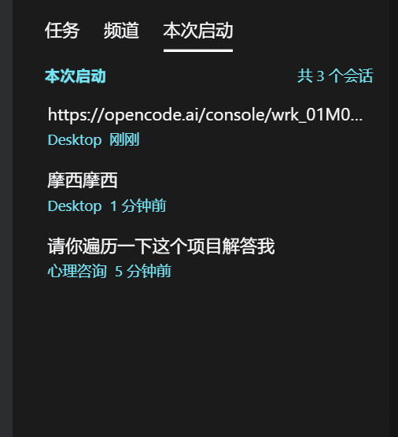

# dsh-run-sessions

> **本次启动（This run）** — 在 DSH 侧栏「任务 / 频道」旁边加一个页签，只列出**本次启动以来聊过的会话**。
> 会话一多，就不用再凭记忆去几十个工作区里翻“刚才那个是哪个”。



一个 [DeepSeek Harness](https://github.com/deepseek-ai) 的侧栏插件：按“本次进程启动”切一刀，
把刚才动过的会话按时间列出来，点一下直接进会话。

---

## 功能

| 功能 | 说明 |
| --- | --- |
| **本次启动** | 只显示 `updatedAt >= 本次进程启动时间` 且不是空白新会话的会话，按最近活动排序 |
| **选中高亮** | 当前打开的会话带底色 + 加粗标题（沿用官方会话行的 `--dsw-alias-interactive-bg-hover`）+ `aria-current` |
| **右键菜单** | 任意会话右键：打开 / 从本次启动移除；移除后在底部一键“恢复” |
| **拖拽排序** | 直接拖动会话改上下顺序，新出现的会话自动排最上面 |
| **留在本页签** | 点开列表里的会话，左侧不会跳回「任务」；频道会话也不会被「频道」页签抢走 |
| **跟随语言** | 文案跟着 DSH 自己的 `locale` 服务走，中英文实时切换 |
| **只读旁挂** | 不接管、不替换官方侧栏；找不到挂载点就什么都不做 |

移出列表和手动顺序都按“本次启动”存（`localStorage`），刷新页面还在，重启 DSH 自动重置。

## 安装

### 方式一：作为本地插件链接（推荐）

```bash
git clone https://github.com/ayachinene285/dsh-run-sessions.git
cd dsh-run-sessions

# 装进当前 profile（桌面版一般是 desktop）
dsh plugin --profile desktop add "$(pwd)"
```

命令行不方便时，手动改 profile 也可以：

1. 把插件目录放进 `~/.dsh/profiles/<profile>/node_modules/dsh-run-sessions`（目录联接/junction 即可）；
2. 在该 profile 的 `package.json` 里：
   - `dependencies` 加 `"dsh-run-sessions": "link:/path/to/dsh-run-sessions"`
   - `dsh.profile.bundles` 数组末尾加 `"dsh-run-sessions"`
3. **完全退出 DSH 再打开**（客户端 bundle 按启动时的版本缓存，刷新页面不生效）。

### 方式二：拷进已有 profile

把 `lib/`、`cordis.patch.yml`、`package.json` 复制成上面对应的 node_modules 目录，同样改 `package.json` 再重启。

## 它是怎么判断“本次启动”的

- 宿主侧（`lib/index.js`）在进程内第一次 import 时记下 `STARTED_AT`，通过一个只读接口暴露：

  ```
  GET /api/dsh-run-sessions/state  ->  { startedAt, now, pid }
  ```

- 页面拿到 `startedAt` 后过滤 `ctx.sessions.list`：`updatedAt >= startedAt` 且 `blank !== true`；
- 每次 DSH 重启 `startedAt` 变化，列表自然重置；刷新页面不影响。

## 它怎么插进侧栏的

侧栏那排「任务 / 频道」是 **dsh-im-connect** 画的：它把官方 `sidebar.workspaces` 包了一层，
并在被包的 slot entry 上挂了 `__dshNativeTabs` 注册表（`insert / getTabs / subscribe / addSessionFilter`）。

本插件只做两件事：

1. `registry.insert({ id, label, order: 30, render, matchSession })` —— 不替换任何官方组件；
2. 通过 `matchSession` 认领“刚从这个页签点开的会话”，这样 im-connect 的 `sidebarTabForSession()`
   不会把侧栏拽回「任务」；粘性窗口内还会临时让「频道」页签不认领该 id，点完立即恢复。

容错：找不到注册表就不动作、`apply()` 全程 try/catch、面板外面套 error boundary —— 最坏也只是少一个页签，
不会拖垮侧栏，更不会让页面起不来。

## 开发

```text
package.json        # dsh.bundle.patch + dsh.client(platform: web)
cordis.patch.yml    # 只 insert 本插件
lib/index.js        # 宿主侧：记录启动时间 + 只读接口
lib/client.js       # 浏览器侧：页签、列表、右键菜单、拖拽
```

没有构建步骤，改完 `lib/client.js` 完全重启 DSH 即可（客户端 bundle 按 mtime/大小算版本，刷新页面拿不到新代码）。

控制台里可以用：

```js
await (await fetch('/api/dsh-run-sessions/state')).json()   // 看本次启动时间
```

调试日志统一以 `[run-sessions]` 开头。

## 已知边界

- 依赖 dsh-im-connect 提供的页签注册表；没装这个插件时本插件不会显示（也不会报错）。
- “本次启动”严格按进程走：DSH 重启后列表清空，这是设计而非 bug。
- 只读客户端已有的会话 store，不额外请求 Host 的会话接口。

## License

[MIT](LICENSE)
